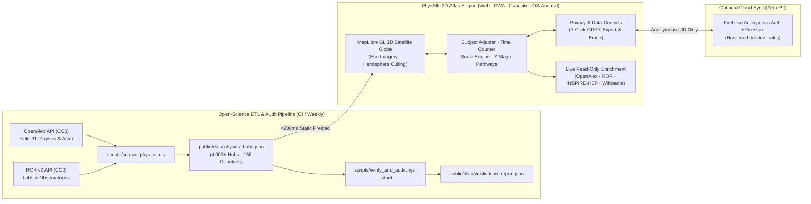

# PhysAlts — World of Physics

**PhysAlts** (`org.physalts.app`) is an interactive, privacy-first **3D global atlas of physics** — mapping **4,000+ physics university departments, national laboratories, particle colliders, observatories, fusion facilities, and research hubs across 156 countries**, paired with historical breakthroughs, cosmic scale visualization, and 7-stage academic career pathways.

Built as a **static-first PWA + Capacitor 6 mobile app (iOS & Android)** and engineered as the reference blueprint for a reusable **Multi-Subject Atlas Engine** (`Physics → AI → All Sciences`).

---

## Architecture Overview



```text
OpenAlex + ROR v2 ──▶ scrape_physics.mjs ──▶ physics_hubs.json ──▶ verify_and_audit.mjs (--strict)
                                                    │
                                                    ▼
                     Web / PWA / Capacitor 6 (3D Globe + Time Counter + Scale View)
                                       │                           │
                        Direct Read-Only APIs            Optional Anonymous Sync
                   (INSPIRE-HEP · Wikimedia · Esri)     (Firebase + firestore.rules)
```

---

## Feature Matrix

| Capability | Description |
|---|---|
| **3D Interactive Satellite Globe** | MapLibre GL CSP WebGL globe with Esri World Imagery, hemisphere culling, rAF-throttled clustering, and 3D geodesic collaboration arcs. |
| **Global Open-Science Index** | 4,000+ physics universities, national labs, synchrotrons, observatories, institutes, and deep-tech hubs across 156 countries preloaded in `<200 ms` from `public/data/physics_hubs.json`. |
| **Time Counter (Historical Epochs)** | Step chronologically across landmark eras of physics discoveries and see where breakthroughs happened on the globe. |
| **Space / Scale Engine** | Transition beyond terrestrial facilities to explore physical & cosmic frontier scales. |
| **7-Stage Career Pathways** | Tailored guidance & fellowships from **High School** → **Undergrad** → **Master's** → **PhD** → **Postdoc** → **Associate Prof** → **Full Professor**, with bookmarkable shortlists. |
| **Live Open-Science Enrichment** | On-demand read-only lookups to OpenAlex, ROR v2, INSPIRE-HEP, and Wikimedia REST API. |
| **Privacy-First & GDPR Controls** | Zero PII, zero GPS tracking, zero ad SDKs, zero third-party cookies, plus in-app **Privacy & Data Controls** (1-click JSON export & local + cloud erasure). |
| **Cross-Platform Delivery** | Works offline-capable as a Web PWA and packages natively for **Android (AAB)** and **iOS (IPA / TestFlight)** via **Capacitor 6**. |

---

## Quickstart

### Prerequisites
- **Node.js 20+** and `npm`

### Run Locally
```bash
# 1. Install dependencies
npm install

# 2. (Optional) Refresh global dataset from OpenAlex & ROR v2
npm run scrape

# 3. Run strict schema, hygiene & live link verification audit
npm run verify
# (or directly: node scripts/verify_and_audit.mjs --strict)

# 4. Launch local dev server with CORS-safe API/tile proxy
npm run dev
```

Open **`http://localhost:5173`** in your browser.

---

## Mobile Packaging (Android & iOS via Capacitor 6)

PhysAlts ships preconfigured for **Capacitor 6** (`org.physalts.app` in `capacitor.config.json`):

```bash
# Add native platforms (first time)
npm run cap:add:android
npm run cap:add:ios

# Sync web assets (public/) into native projects
npm run cap:sync

# Open native IDEs
npm run cap:android   # Android Studio
npm run cap:ios       # Xcode (macOS)
```

For full signing instructions (Android Upload Keystore & AAB, adaptive icons, safe-area layout, iOS Xcode signing, **Codemagic CI/CD for Linux/Ubuntu developers without a Mac**, and **public Firebase Hosting + Firestore deployment from a private GitHub repo** using Google AI Pro credits + `firebase.json`), see:
- [`docs/MOBILE_RELEASE_GUIDE.md`](./docs/MOBILE_RELEASE_GUIDE.md)

---

## Security, Compliance & CI Quality Gates

PhysAlts embeds security and privacy controls directly into the repository and CI/CD pipeline:

- **Hardened Firestore Rules ([`firestore.rules`](./firestore.rules)):** Whitelisted document keys, coordinate bounds (`-90..90`, `-180..180`), HTTPS-only URL enforcement, immutable public community nodes, and explicit owner-only `delete` supporting GDPR Article 17 (Right to Erasure).
- **GDPR Privacy & Open Data Policy ([`public/privacy.html`](./public/privacy.html)):** Transparent GDPR Articles 13–17 notice, sub-processor register, and nominative fair-use attribution.
- **Automated Security & QA Workflow ([`.github/workflows/security-and-qa.yml`](./.github/workflows/security-and-qa.yml)):** Runs on every `push` and `pull_request` to `main` — executes `node scripts/verify_and_audit.mjs --strict`, `npm audit --audit-level=high`, secret-leak scanning, `firestore.rules` structural validation, and uploads `public/data/verification_report.json` as a 30-day audit artifact.
- **Weekly Refresh & Deployment ([`.github/workflows/update-and-deploy.yml`](./.github/workflows/update-and-deploy.yml)):** Automated weekly OpenAlex/ROR dataset refresh and GitHub Pages deployment.
- **SOC 2 Readiness & GDPR Blueprint ([`docs/COMPLIANCE_SOC2_GDPR.md`](./docs/COMPLIANCE_SOC2_GDPR.md)):** Full SOC 2 Trust Services Criteria (CC1–CC9, Availability, Processing Integrity, Confidentiality, Privacy) mapping, honest distinction between technical readiness controls and external CPA audits, GDPR checklist, and exact Apple App Store Privacy Nutrition Label & Google Play Data Safety answers.

---

## Reusable Multi-Subject Atlas Engine ("Physics → AI → All Sciences")

PhysAlts is built so you can clone the engine and launch a new global atlas for another field — starting with **AI Atlas (`aialts`)** — in **1 day** by swapping the Subject Adapter (`config.js`), Time Counter epochs, Scale axis (e.g., Training Compute `10³ → 10²⁶+ FLOP`), and open-registry ETL queries.

Read the complete architectural blueprint and hour-by-hour AI Atlas cloning guide:
- [`docs/ATLAS_ENGINE_PLAYBOOK.md`](./docs/ATLAS_ENGINE_PLAYBOOK.md)

---

## Open Data Attribution & Fair Use

- **OpenAlex** (`api.openalex.org`) — CC0 1.0 Public Domain
- **Research Organization Registry (ROR v2)** (`api.ror.org`) — CC0 1.0 Public Domain
- **INSPIRE-HEP** (`inspirehep.net`) — CC0 1.0 Public Domain
- **Wikimedia REST API / Wikipedia** — CC BY-SA 4.0
- **Esri World Imagery** — Satellite basemap tiles (Esri attribution)

University, national laboratory, and observatory names are listed for factual educational directory purposes under nominative fair use. PhysAlts is an independent open-science platform and is not affiliated with or endorsed by CERN, NASA, ESO, or any listed institution.
